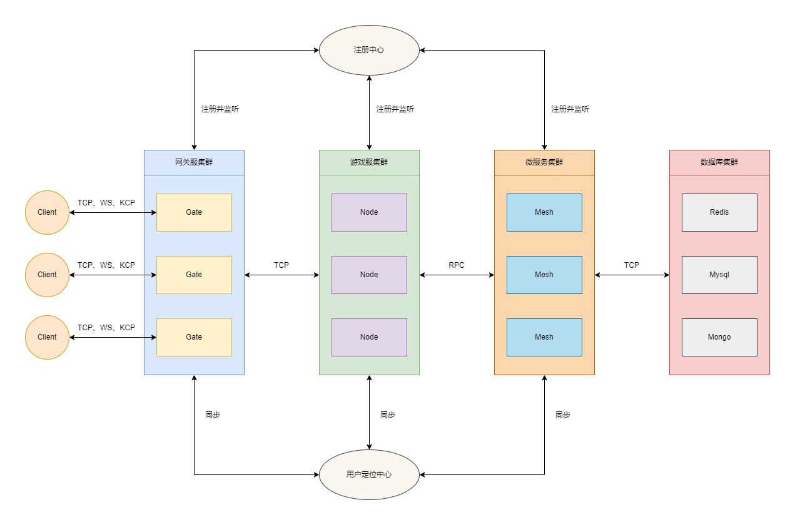
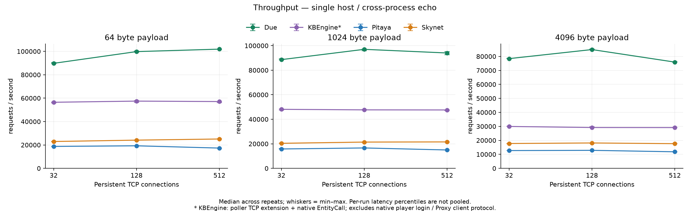
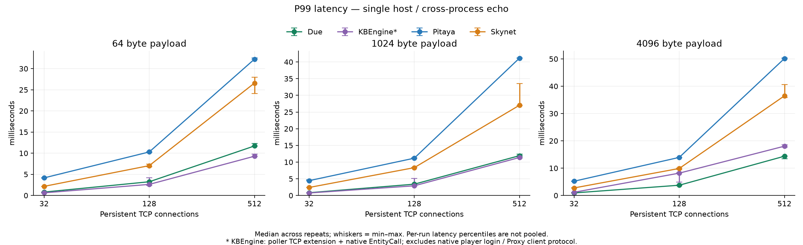
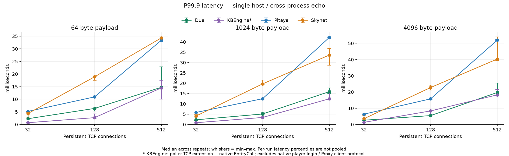
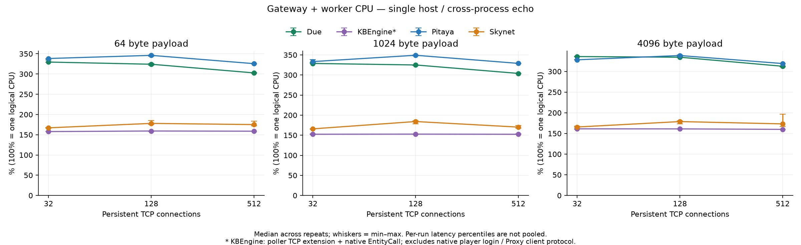
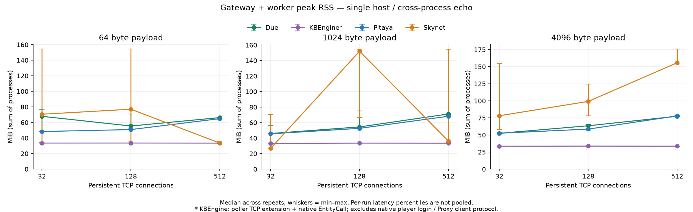
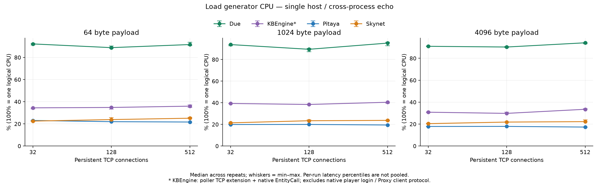

[English](README.md) | 简体中文

# due 基于Go语言开发的高性能分布式游戏服务器框架

[](https://github.com/dobyte/due/actions)
[](https://github.com/dobyte/due)
[](https://pkg.go.dev/github.com/dobyte/due/v2)
[](https://opensource.org/licenses/MIT)
[](https://goreportcard.com/report/github.com/dobyte/due)
[](https://codecov.io/gh/dobyte/due)
[](https://github.com/avelino/awesome-go)

[](https://github.com/dobyte/due/releases)


[](https://github.com/dobyte/due/pulls)
[](https://github.com/dobyte/due/pulls?q=is%3Apr+is%3Aclosed)
[](https://github.com/dobyte/due/issues)
[](https://github.com/dobyte/due/issues?q=is%3Aissue+is%3Aclosed)

### 1.介绍

[due](https://dobyte.github.io/) 是一款基于Go语言开发的开箱即用、轻量级、高性能分布式游戏服务器框架，内置完整集群方案，单线程即可轻松支撑43W TPS——历经多个企业级游戏项目实战检验，稳定性有充分的保障。
其中，模块设计方面借鉴了[kratos](https://github.com/go-kratos/kratos)的模块设计思路，旨在为游戏服务器开发提供完善、高效、优雅、标准化的解决方案。



### 2.优势

* 💰 免费性：框架遵循MIT协议，完全开源免费。
* 💡 简单性：架构简单，源码简洁易理解。
* 🚠 便捷性：仅暴露必要的调用接口，减轻开发者的心智负担。
* 🚀 高性能：框架原生实现集群通信方案，普通机器单线程也能轻松实现43W的TPS。
* 🧊 标准化：框架原生提供标准化的开发规范，无论多么复杂的项目也能轻松应对。
* ✈️ 高效性：框架原生提供tcp、kcp、ws、quic等服务器，方便开发者快速构建各种类型的网关服务器。
* ⚖️ 稳定性：所有发布的正式版本均已通过内部真实业务的严格测试，具备较高的稳定性。
* 🎟️ 扩展性：采用良好的接口设计，方便开发者设计实现自有功能。
* 🔑 平滑性：引入信号量，通过控制服务注册中心来实现优雅地滚动更新。
* 🔩 扩容性：通过优雅的路由分发机制，理论上可实现无限扩容。
* 🔧 易调试：框架原生提供了tcp、kcp、ws、quic等客户端，方便开发者进行独立的全流程调试。
* 🧰 可管理：提供完善的后台管理接口，方便开发者快速实现自定义的后台管理功能。

### 3.功能

* 网关：支持tcp、kcp、ws、quic等协议的网关服务器。
* 日志：支持console、file、aliyun、tencent等多种日志组件。
* 注册：支持etcd、consul、nacos、polaris等多种服务注册中心。
* 协议：支持json、protobuf、msgpack、xml、yaml、toml等多种通信协议。
* 配置：支持file、etcd、consul、nacos、polaris等多种配置中心；并支持json、yaml、toml、xml等多种文件格式。
* 通信：支持grpc、rpcx等多种高性能通信方案。
* 重启：支持服务器的平滑重启。
* 事件：支持process、redis、nats、kafka等事件总线实现方案。
* 加密：支持rsa、ecc等多种加密与签名方案。
* 服务：支持grpc、rpcx等多种微服务解决方案。
* 灵活：支持单体、分布式等多种架构方案。
* Web：提供http协议的fiber服务器及swagger文档解决方案。
* 工具：提供[due-cli](https://github.com/dobyte/due-cli)脚手架工具箱，可快速构建集群项目。
* 缓存：支持redis、memcache等多种常用的缓存方案。
* Actor：提供完善actor模型解决方案。
* 分布式锁：支持redis、memcache等多种分布式锁解决方案。
* 网络：支持tcp、kcp、ws、quic四种协议的服务器与客户端，并提供统一的心跳、授权、优雅关闭与连接管理能力。

> 下一期规划：分布式任务调度系统

### 4.架构与核心概念

#### 4.1 组件与容器

due采用「容器+组件」的模块化设计。框架把网关（gate）、节点（node）、微服务（mesh）、集群客户端（client），以及日志、HTTP、pprof等能力统一抽象为组件（Component），由容器（Container）统一编排其生命周期：

```go
type Component interface {
    Name() string // 组件名称
    Init()        // 初始化组件
    Start()       // 启动组件
    Close()       // 关闭组件
    Destroy()     // 销毁组件
}

func main() {
    container := due.NewContainer() // 创建容器
    container.Add(component)        // 添加组件，可多次添加
    container.Serve()               // 启动容器并等待系统信号
}
```

`Serve`的执行顺序为：打印框架信息 → 依次`Init`各组件 → 依次`Start`各组件 → 写入PID文件 → 等待系统信号 → 并发`Close`各组件 → 并发`Destroy`各组件 → 清理PID与全局模块。

* 信号监听：Windows监听`os.Interrupt`，其他系统监听`SIGINT`、`SIGQUIT`、`SIGABRT`、`SIGTERM`。
* 关闭超时：`Close`阶段由`etc.shutdownMaxWaitTime`控制；`Destroy`阶段固定5秒超时。
* 平滑重启：Gate/Node/Mesh在`Close`阶段将自身状态置为`hang`并刷新注册中心中的实例状态，使新流量不再进入该实例，同时等待存量会话与消息处理完毕；真正的解注册发生在`Destroy`阶段。配合信号量即可实现滚动更新。

#### 4.2 实例类型（Kind）

| 常量 | 值 | 字符串 | 说明 |
| --- | --- | --- | --- |
| `cluster.Gate` | 1 | gate | 网关服 |
| `cluster.Node` | 2 | node | 节点服 |
| `cluster.Mesh` | 3 | mesh | 微服务 |
| `cluster.Master` | 4 | master | 管理服 |

#### 4.3 实例状态（State）

| 常量 | 值 | 字符串 | 说明 |
| --- | --- | --- | --- |
| `cluster.Shut` | 0 | shut | 关闭 |
| `cluster.Work` | 1 | work | 工作 |
| `cluster.Busy` | 2 | busy | 繁忙 |
| `cluster.Hang` | 3 | hang | 挂起 |

> 网关仅在`work`、`busy`状态下接受新的客户端连接，其余状态下直接关闭连接。

#### 4.4 生命周期钩子（Hook）

| 常量 | 值 | 说明 |
| --- | --- | --- |
| `cluster.Init` | 0 | 初始组件 |
| `cluster.Start` | 1 | 启动组件 |
| `cluster.Close` | 2 | 关闭组件 |
| `cluster.Destroy` | 3 | 销毁组件 |

节点（node）、微服务（mesh）与集群客户端（client）组件可通过`Proxy.AddHookListener(hook, handler)`监听自身生命周期，常用于在组件启动后建立连接等初始化工作。

#### 4.5 事件类型（Event）

| 常量 | 值 | 说明 |
| --- | --- | --- |
| `cluster.Connect` | 1 | 打开连接 |
| `cluster.Reconnect` | 2 | 断线重连 |
| `cluster.Disconnect` | 3 | 断开连接 |

#### 4.6 分发策略（Dispatch）

集群实例之间的负载分发策略：

| 常量 | 值 | 说明 |
| --- | --- | --- |
| `cluster.Random` | random | 随机 |
| `cluster.RoundRobin` | rr | 轮询 |
| `cluster.WeightedRoundRobin` | wrr | 加权轮询 |

集群内部传输层（grpc/rpcx）还额外支持一致哈希策略（`ch`），用于按请求特征将调用固定到同一实例。

#### 4.7 Gate、Node、Mesh与Client

> 在due交流群中经常有小伙伴提及到Gate、Node、Mesh之间到底是个什么关系，这里就做一个统一的解答

* Gate：网关服，主要用于管理客户端连接，接收客户端的路由消息，并分发路由消息到不同的Node节点服。
* Node：节点服，作为整个集群系统的核心组件，主要用于核心逻辑业务的编写。Node节点服务可以根据业务需要做成有状态或无状态的节点，当作为无状态的节点时，Node节点与Mesh微服务基本无异；但当Node节点作为有状态节点时，Node节点便不能随意更新进行重启操作。故而Node与Mesh分离的业务场景的价值就体现出来了。
* Mesh：微服务，主要用于无状态的业务逻辑编写。Mesh能做的功能Node一样可以完成，如何选择完全取决于自身业务场景，开发者可以根据自身业务场景灵活搭配。
* Client：集群客户端组件，可直接拨号连接网关，便于在服务端工程内编写自动化测试、压测程序或机器人逻辑，实现了全流程的独立调试。

### 5.项目结构

```text
due/
├── container.go            容器入口（根包唯一源码文件）
├── cluster/                集群组件
│   ├── cluster.go          集群模型：Kind/State/Event/Hook/Dispatch与集群消息结构
│   ├── gate/               网关服组件
│   ├── node/               节点服组件（路由、事件、Actor模型）
│   ├── mesh/               微服务组件
│   └── client/             集群客户端组件
├── network/                网络模块：tcp、kcp、ws、quic
├── session/                网关会话管理：连接会话、用户会话与频道订阅
├── packet/                 通信协议打包：Packer与Message
├── internal/               内部实现：集群链接器、实例分发器、内网RPC协议
├── registry/               注册中心：etcd、consul、nacos、polaris
├── config/                 配置中心：file、etcd、consul、nacos、polaris
├── locate/                 用户定位：redis
├── transport/              集群内部传输：grpc、rpcx
├── eventbus/               事件总线：process、redis、nats、kafka
├── cache/                  缓存：redis、memcache
├── lock/                   分布式锁：redis、memcache
├── crypto/                 加解密与签名：rsa、ecc
├── encoding/               编解码器：json、proto、msgpack、xml、yaml、toml
├── log/                    日志：console、file、aliyun、tencent
├── component/              内置组件：http、mqtt、pprof
├── core/                   核心基础库：buffer、queue、value、stack、limiter等
├── utils/                  工具库：xcall、xconv、xnet、xtime、xhash等
├── codes/、errors/         错误码与错误定义
├── mode/、flag/、env/、etc/ 运行模式、命令行参数、环境变量与启动配置
├── task/                   全局任务池与任务组
├── docker/                 中间件编排（docker-compose.yaml）
├── benchmark/              压测工程（独立Go模块）
└── testdata/               示例配置与测试数据
```

### 6.模块清单

框架采用多模块发布：核心能力位于主模块`github.com/dobyte/due/v2`，可插拔组件各自独立成模块，便于按需引入。

| 分类 | 组件 | 引入路径 |
| --- | --- | --- |
| 核心 | 框架主模块 | `github.com/dobyte/due/v2` |
| 网络 | tcp | `github.com/dobyte/due/network/tcp/v2` |
| 网络 | kcp | `github.com/dobyte/due/network/kcp/v2` |
| 网络 | ws | `github.com/dobyte/due/network/ws/v2` |
| 网络 | quic | `github.com/dobyte/due/network/quic/v2` |
| 注册中心 | etcd | `github.com/dobyte/due/registry/etcd/v2` |
| 注册中心 | consul | `github.com/dobyte/due/registry/consul/v2` |
| 注册中心 | nacos | `github.com/dobyte/due/registry/nacos/v2` |
| 注册中心 | polaris | `github.com/dobyte/due/registry/polaris/v2` |
| 配置中心 | file（内置） | `github.com/dobyte/due/v2/config/file` |
| 配置中心 | etcd | `github.com/dobyte/due/config/etcd/v2` |
| 配置中心 | consul | `github.com/dobyte/due/config/consul/v2` |
| 配置中心 | nacos | `github.com/dobyte/due/config/nacos/v2` |
| 配置中心 | polaris | `github.com/dobyte/due/config/polaris/v2` |
| 定位 | redis | `github.com/dobyte/due/locate/redis/v2` |
| 传输 | grpc | `github.com/dobyte/due/transport/grpc/v2` |
| 传输 | rpcx | `github.com/dobyte/due/transport/rpcx/v2` |
| 事件总线 | process（内置） | `github.com/dobyte/due/v2/eventbus/process` |
| 事件总线 | redis | `github.com/dobyte/due/eventbus/redis/v2` |
| 事件总线 | nats | `github.com/dobyte/due/eventbus/nats/v2` |
| 事件总线 | kafka | `github.com/dobyte/due/eventbus/kafka/v2` |
| 缓存 | redis | `github.com/dobyte/due/cache/redis/v2` |
| 缓存 | memcache | `github.com/dobyte/due/cache/memcache/v2` |
| 分布式锁 | redis | `github.com/dobyte/due/lock/redis/v2` |
| 分布式锁 | memcache | `github.com/dobyte/due/lock/memcache/v2` |
| 加解密 | rsa | `github.com/dobyte/due/crypto/rsa/v2` |
| 加解密 | ecc | `github.com/dobyte/due/crypto/ecc/v2` |
| 日志 | console（内置） | `github.com/dobyte/due/v2/log/console` |
| 日志 | file（内置） | `github.com/dobyte/due/v2/log/file` |
| 日志 | aliyun | `github.com/dobyte/due/log/aliyun/v2` |
| 日志 | tencent | `github.com/dobyte/due/log/tencent/v2` |
| 组件 | http | `github.com/dobyte/due/component/http/v2` |
| 组件 | mqtt | `github.com/dobyte/due/component/mqtt/v2` |
| 组件 | pprof（内置） | `github.com/dobyte/due/v2/component/pprof` |

> 编解码器（`encoding/*`）、协议打包（`packet`）、核心基础库（`core/*`）、工具库（`utils/*`）均内置于主模块，无需单独引入。

### 7.通信协议

在due框架中，通信协议统一采用size+header+route+seq+message的格式：

1.数据包

```
 0 1 2 3 4 5 6 7 0 1 2 3 4 5 6 7 0 1 2 3 4 5 6 7 0 1 2 3 4 5 6 7 0 1 2 3 4 5 6 7 0 1 2 3 4 5 6 7 0 1 2 3 4 5 6 7 0 1 2 3 4 5 6 7 0 1 2 3 4 5 6 7
+---------------------------------------------------------------+-+-------------+-------------------------------+-------------------------------+
|                              size                             |h|   extcode   |             route             |              seq              |
+---------------------------------------------------------------+-+-------------+-------------------------------+-------------------------------+
|                                                                message data ...                                                               |
+-----------------------------------------------------------------------------------------------------------------------------------------------+
```

2.心跳包

```
 0 1 2 3 4 5 6 7 0 1 2 3 4 5 6 7 0 1 2 3 4 5 6 7 0 1 2 3 4 5 6 7 0 1 2 3 4 5 6 7 0 1 2 3 4 5 6 7 0 1 2 3 4 5 6 7 0 1 2 3 4 5 6 7 0 1 2 3 4 5 6 7
+---------------------------------------------------------------+-+-------------+---------------------------------------------------------------+
|                              size                             |h|   extcode   |                      heartbeat time (ns)                      |
+---------------------------------------------------------------+-+-------------+---------------------------------------------------------------+
```

size: 4 bytes

- 包长度位
- 固定长度为4字节，且不可修改

header: 1 bytes

h: 1 bit

- 心跳标识位
- %x0 表示数据包
- %x1 表示心跳包

extcode: 7 bit

- 扩展操作码
- 暂未明确定义具体操作码

route: 1 bytes | 2 bytes | 4 bytes

- 消息路由
- 默认采用2字节，可通过打包器配置packet.routeBytes进行修改
- 不同的路由对应不同的业务处理流程
- 心跳包无消息路由位
- 此参数由业务打包器打包，服务器开发者和客户端开发者均要关心此参数

seq: 0 bytes | 1 bytes | 2 bytes | 4 bytes

- 消息序列号
- 默认采用2字节，可通过打包器配置packet.seqBytes进行修改
- 可通过将打包器配置packet.seqBytes设置为0来屏蔽使用序列号
- 消息序列号常用于请求/响应模型的消息对儿的确认
- 心跳包无消息序列号位
- 此参数由业务打包器packet.Packer打包，服务器开发者和客户端开发者均要关心此参数

message data: n bytes

- 消息数据
- 心跳包无消息数据
- 此参数由业务打包器packet.Packer打包，服务器开发者和客户端开发者均要关心此参数

heartbeat time: 8 bytes

- 心跳数据
- 数据包无心跳数据
- 上行心跳包无需携带心跳数据，下行心跳包默认携带8 bytes的服务器时间（ns），可通过网络库配置进行设置是否携带下行包时间信息
- 此参数由网络框架层自动打包，服务端开发者不关注此参数，客户端开发者需关注此参数

### 8.相关工具链

1.安装protobuf编译器（使用场景：开发mesh微服务）

- Linux, using apt or apt-get, for example:

```shell
$ apt install -y protobuf-compiler
$ protoc --version  # Ensure compiler version is 3+
```

- MacOS, using Homebrew:

```shell
$ brew install protobuf
$ protoc --version  # Ensure compiler version is 3+
```

- Windows, download from [Github](https://github.com/protocolbuffers/protobuf/releases):

2.安装protobuf go代码生成工具（使用场景：开发mesh微服务）

```shell
go install google.golang.org/protobuf/cmd/protoc-gen-go@latest
```

3.安装grpc代码生成工具（使用场景：使用[GRPC](https://grpc.io/)组件开发mesh微服务）

```shell
go install google.golang.org/grpc/cmd/protoc-gen-go-grpc@latest
```

4.安装rpcx代码生成工具（使用场景：使用[RPCX](https://rpcx.io/)组件开发mesh微服务）

```shell
go install github.com/rpcxio/protoc-gen-rpcx@latest
```

5.安装gorm dao代码生成工具（使用场景：使用[GORM](https://gorm.io/)作为数据库orm）

```shell
go install github.com/dobyte/gorm-dao-generator@latest
```

6.安装mongo dao代码生成工具（使用场景：使用[MongoDB](https://github.com/mongodb/mongo-go-driver)作为数据库orm）

```shell
go install github.com/dobyte/mongo-dao-generator@latest
```

### 9.配置中心

1.功能介绍

配置中心主要定位于业务的配置管理，提供快捷灵活的配置方案。支持完善的读取、修改、删除、热更新等功能。

核心接口为`config.Configurator`，主要方法：`Has`、`Get`、`Set`、`Match`、`Watch`（监听配置变更）、`Load`、`Store`、`Close`。其实现按「配置源（Source）+ 编解码（Codec）」解耦，因此配置文件格式与配置源相互独立。

2.支持的组件

* [file](config/file/README-ZH.md)
* [etcd](config/etcd/README-ZH.md)
* [consul](config/consul/README-ZH.md)
* [nacos](config/nacos)
* [polaris](config/polaris/README-ZH.md)

3.支持的配置格式

json、yaml（yml）、toml、xml。

### 10.注册中心

1.功能介绍

注册中心用于集群实例的服务注册和发现。支撑整个集群的无感知停服、重启、动态扩容等功能。

核心接口为`registry.Registry`，主要方法：`Register`、`Deregister`、`Watch`（监听实例变更）、`Services`、`Close`；配套`registry.Watcher`用于消费实例变更事件。实例信息由`registry.ServiceInstance`描述，包含实例ID、名称、类型（Kind）、状态（State）、路由（Routes）、事件（Events）、服务（Services）、端点（Endpoint）、权重（Weight）与元数据（Metadata）。

2.支持的组件

* [etcd](registry/etcd/README-ZH.md)
* [consul](registry/consul/README-ZH.md)
* [nacos](registry/nacos)
* [polaris](registry/polaris)

### 11.网络模块

1.功能介绍

网络模块主要以组件的形式集成于网关模块，为网关提供灵活的网络通信支持。四种协议实现完全一致的接口（`network.Server`、`network.Client`、`network.Conn`），网关组件可在不修改业务代码的前提下自由切换。

2.支持的协议

| 协议 | 传输层 | 底层依赖 | 典型场景 |
| --- | --- | --- | --- |
| [tcp](network/tcp) | TCP | 标准库net | 内网长连接、性能要求最高的场景 |
| [ws](network/ws) | TCP（WebSocket） | gorilla/websocket | 浏览器、H5、小程序等Web端接入 |
| [kcp](network/kcp) | UDP（可靠传输） | xtaci/kcp-go/v5 | 移动网络、弱网环境 |
| [quic](network/quic/README.md) | UDP（TLS 1.3多路复用） | quic-go | 弱网且要求强安全、连接迁移的场景 |

3.通用能力

* 心跳检测：支持`resp`（响应式，由客户端心跳驱动）与`tick`（服务端主动定时下发）两种机制，间隔为0表示关闭定时心跳。
* 授权超时：连接建立后在指定时间内未绑定用户ID则自动关闭连接。
* 优雅关闭：先排空写队列再关闭连接，可通过`closeTimeout`限制排空等待上限；强制关闭则立即中断。
* 有界写队列与写超时（`writeQueueSize`、`writeTimeout`），队列满时按写超时返回错误。
* 最大连接数限制（`maxConnNum`）、连接ID、用户ID绑定（`Bind`/`Unbind`）与自定义属性（`Attr`）。
* 统一的对象池复用与分片连接管理，支持服务器停止后重启。
* tcp/ws/kcp支持ProxyProtocol；tcp/ws支持TLS/HTTPS。

4.配置项

各协议配置项位于`etc.network.<协议>.server.*`与`etc.network.<协议>.client.*`，也可通过对应的`WithServer*`/`WithClient*`函数设置：

| 配置项 | tcp | ws | kcp | quic | 说明 |
| --- | --- | --- | --- | --- | --- |
| addr | :3553 | :3553 | :3553 | :3553 | 监听地址 |
| maxConnNum | 5000 | 5000 | 5000 | 5000 | 最大连接数 |
| writeQueueSize | 1024 | 1024 | 1024 | 1024 | 写队列大小 |
| writeTimeout | 0s | 0s | 0s | 0s | 写超时时间，0表示不限制 |
| heartbeatInterval | 10s | 10s | 10s | 10s | 心跳间隔时间 |
| heartbeatMechanism | resp | resp | resp | resp | 心跳机制 |
| authorizeTimeout | 0s | 0s | 0s | 0s | 授权超时时间，0表示不检测 |
| closeTimeout | 0s | 0s | 0s | 5s | 优雅关闭排空上限，0表示不限制 |
| readBufferSize | 4096 | 4096 | - | - | 读缓冲区大小 |
| certFile / keyFile | 可选 | 可选 | - | 必填 | 证书与私钥 |
| enableProxyProtocol | false | - | false | - | 是否启用ProxyProtocol |
| handshakeTimeout | - | - | - | 5s | QUIC握手与首流等待超时 |
| path | - | / | - | - | WebSocket连接路径 |
| origins | - | * | - | - | WebSocket跨域白名单 |
| writeBufferSize | - | 4096 | - | - | WebSocket写缓冲区 |
| enableCompression | - | false | - | - | 是否开启压缩 |
| compressionLevel | - | 1 | - | - | 压缩等级（1-9） |
| proxyMode | - | none | - | - | 代理模式：none/transport/application |
| mtu | - | - | 1400 | - | KCP最大传输单元 |
| noDelay | - | - | [1,10,2,1] | - | KCP无延迟模式参数 |
| windowSize | - | - | [32,32] | - | KCP发送/接收窗口 |
| ackNoDelay / writeDelay | - | - | 可选 / true | - | KCP ACK与写延迟参数 |
| readBuffer / writeBuffer | - | - | 可选 | - | KCP套接字读写缓冲 |

> 表中未列出的协议专属参数请参考对应目录下的`server_options.go`、`client_options.go`。

5.使用示例

```go
// 服务端
server := ws.NewServer(ws.WithServerAddr("0.0.0.0:3553"))
server.OnReceive(func(conn network.Conn, buf buffer.Buffer) {
    defer buf.Release()
    // 处理业务消息
})
if err := server.Start(); err != nil {
    log.Fatalf("start server failed: %v", err)
}

// 客户端（可用于独立调试）
client := ws.NewClient(ws.WithClientUrl("ws://127.0.0.1:3553"))
conn, err := client.Dial()
```

6.使用须知

* Buffer所有权：`Push`返回nil表示缓冲区所有权已移交网络层，由网络层负责释放；返回错误时由调用方自行释放。`OnReceive`回调接收的缓冲区由业务层负责释放。
* 未注册`OnReceive`回调时，收到的消息缓冲区会被自动释放。
* 服务端连接的`Close`语义为「等待写队列排空」，可在回调中调用；但不要在`OnClose`/`OnDisconnect`等回调中同步调用服务器`Stop`，以免阻塞。
* 网关消息经`packet`模块打包，消息体为`route`+`seq`+`message`结构，详见「通信协议」章节。


### 12.快速开始

下面我们就通过两段简单的代码来体验一下due的魅力，Let's go~~

1.启动组件

```shell
docker-compose up
```

> docker-compose.yaml文件已在docker目录中备好，可以直接取用

2.获取框架

```shell
go get -u github.com/dobyte/due/v2@latest
go get -u github.com/dobyte/due/locate/redis/v2@latest
go get -u github.com/dobyte/due/network/ws/v2@latest
go get -u github.com/dobyte/due/registry/consul/v2@latest
go get -u github.com/dobyte/due/transport/rpcx/v2@latest
```

3.构建Gate服务器

```go
package main

import (
   "github.com/dobyte/due/locate/redis/v2"
   "github.com/dobyte/due/network/ws/v2"
   "github.com/dobyte/due/registry/consul/v2"
   "github.com/dobyte/due/v2"
   "github.com/dobyte/due/v2/cluster/gate"
)

func main() {
   // 创建容器
   container := due.NewContainer()
   // 创建服务器
   server := ws.NewServer()
   // 创建用户定位器
   locator := redis.NewLocator()
   // 创建服务发现
   registry := consul.NewRegistry()
   // 创建网关组件
   component := gate.NewGate(
      gate.WithServer(server),
      gate.WithLocator(locator),
      gate.WithRegistry(registry),
   )
   // 添加网关组件
   container.Add(component)
   // 启动容器
   container.Serve()
}
```

4.启动Gate服务器

```shell
$ go run main.go
                    ____  __  ________
                   / __ \/ / / / ____/
                  / / / / / / / __/
                 / /_/ / /_/ / /___
                /_____/\____/_____/
┌──────────────────────────────────────────────────────┐
| [Website] https://github.com/dobyte/due              |
| [Version] v2.6.2                                     |
└──────────────────────────────────────────────────────┘
┌────────────────────────Global────────────────────────┐
| PID: 27159                                           |
| Mode: debug                                          |
└──────────────────────────────────────────────────────┘
┌─────────────────────────Gate─────────────────────────┐
| Name: gate                                           |
| Link: 172.22.243.151:46545                           |
| Server: [ws] 0.0.0.0:3553                            |
| Locator: redis                                       |
| Registry: consul                                     |
└──────────────────────────────────────────────────────┘
```

5.构建Node服务器

```go
package main

import (
   "fmt"
   "github.com/dobyte/due/locate/redis/v2"
   "github.com/dobyte/due/registry/consul/v2"
   "github.com/dobyte/due/v2"
   "github.com/dobyte/due/v2/cluster/node"
   "github.com/dobyte/due/v2/codes"
   "github.com/dobyte/due/v2/log"
   "github.com/dobyte/due/v2/utils/xtime"
)

const greet = 1

func main() {
   // 创建容器
   container := due.NewContainer()
   // 创建用户定位器
   locator := redis.NewLocator()
   // 创建服务发现
   registry := consul.NewRegistry()
   // 创建节点组件
   component := node.NewNode(
      node.WithLocator(locator),
      node.WithRegistry(registry),
   )
   // 初始化监听
   initListen(component.Proxy())
   // 添加节点组件
   container.Add(component)
   // 启动容器
   container.Serve()
}

// 初始化监听
func initListen(proxy *node.Proxy) {
   proxy.Router().AddRouteHandler(greet, false, greetHandler)
}

type greetReq struct {
   Message string `json:"message"`
}

type greetRes struct {
   Code    int    `json:"code"`
   Message string `json:"message"`
}

func greetHandler(ctx node.Context) {
   req := &greetReq{}
   res := &greetRes{}
   defer func() {
      if err := ctx.Response(res); err != nil {
         log.Errorf("response message failed: %v", err)
      }
   }()

   if err := ctx.Parse(req); err != nil {
      log.Errorf("parse request message failed: %v", err)
      res.Code = codes.InternalError.Code()
      return
   }

   log.Info(req.Message)

   res.Code = codes.OK.Code()
   res.Message = fmt.Sprintf("I'm server, and the current time is: %s", xtime.Now().Format(xtime.DateTime))
}
```

6.启动Node服务器
```shell
$ go run main.go
                    ____  __  ________
                   / __ \/ / / / ____/
                  / / / / / / / __/
                 / /_/ / /_/ / /___
                /_____/\____/_____/
┌──────────────────────────────────────────────────────┐
| [Website] https://github.com/dobyte/due              |
| [Version] v2.6.2                                     |
└──────────────────────────────────────────────────────┘
┌────────────────────────Global────────────────────────┐
| PID: 27390                                           |
| Mode: debug                                          |
└──────────────────────────────────────────────────────┘
┌─────────────────────────Node─────────────────────────┐
| Name: node                                           |
| Link: 172.22.243.151:37901                           |
| Codec: json                                          |
| Locator: redis                                       |
| Registry: consul                                     |
| Encryptor: -                                         |
| Transporter: -                                       |
└──────────────────────────────────────────────────────┘
```

7.构建测试客户端

```go
package main

import (
   "fmt"
   "github.com/dobyte/due/eventbus/nats/v2"
   "github.com/dobyte/due/network/ws/v2"
   "github.com/dobyte/due/v2"
   "github.com/dobyte/due/v2/cluster"
   "github.com/dobyte/due/v2/cluster/client"
   "github.com/dobyte/due/v2/eventbus"
   "github.com/dobyte/due/v2/log"
   "github.com/dobyte/due/v2/utils/xtime"
   "time"
)

const greet = 1

func main() {
   // 初始化事件总线
   eventbus.SetEventbus(nats.NewEventbus())
   // 创建容器
   container := due.NewContainer()
   // 创建客户端组件
   component := client.NewClient(
      client.WithClient(ws.NewClient()),
   )
   // 初始化监听
   initListen(component.Proxy())
   // 添加客户端组件
   container.Add(component)
   // 启动容器
   container.Serve()
}

// 初始化监听
func initListen(proxy *client.Proxy) {
   // 监听组件启动
   proxy.AddHookListener(cluster.Start, startHandler)
   // 监听连接建立
   proxy.AddEventListener(cluster.Connect, connectHandler)
   // 监听消息回复
   proxy.AddRouteHandler(greet, greetHandler)
}

// 组件启动处理器
func startHandler(proxy *client.Proxy) {
   if _, err := proxy.Dial(); err != nil {
      log.Errorf("gate connect failed: %v", err)
      return
   }
}

// 连接建立处理器
func connectHandler(conn *client.Conn) {
   doPushMessage(conn)
}

// 消息回复处理器
func greetHandler(ctx *client.Context) {
   res := &greetRes{}

   if err := ctx.Parse(res); err != nil {
      log.Errorf("invalid response message, err: %v", err)
      return
   }

   if res.Code != 0 {
      log.Errorf("node response failed, code: %d", res.Code)
      return
   }

   log.Info(res.Message)

   time.AfterFunc(time.Second, func() {
      doPushMessage(ctx.Conn())
   })
}

// 推送消息
func doPushMessage(conn *client.Conn) {
   err := conn.Push(&cluster.Message{
      Route: 1,
      Data: &greetReq{
         Message: fmt.Sprintf("I'm client, and the current time is: %s", xtime.Now().Format(xtime.DateTime)),
      },
   })
   if err != nil {
      log.Errorf("push message failed: %v", err)
   }
}

type greetReq struct {
   Message string `json:"message"`
}

type greetRes struct {
   Code    int    `json:"code"`
   Message string `json:"message"`
}
```

8.启动客户端
```shell
$ go run main.go
                    ____  __  ________
                   / __ \/ / / / ____/
                  / / / / / / / __/
                 / /_/ / /_/ / /___
                /_____/\____/_____/
┌──────────────────────────────────────────────────────┐
| [Website] https://github.com/dobyte/due              |
| [Version] v2.6.2                                     |
└──────────────────────────────────────────────────────┘
┌────────────────────────Global────────────────────────┐
| PID: 27801                                           |
| Mode: debug                                          |
└──────────────────────────────────────────────────────┘
┌────────────────────────Client────────────────────────┐
| Name: client                                         |
| Codec: json                                          |
| Protocol: ws                                         |
| Encryptor: -                                         |
└──────────────────────────────────────────────────────┘
INFO[2024/07/03 14:53:08.969845] main.go:72 [I'm server, and the current time is: 2024-07-03 14:53:08]
INFO[2024/07/03 14:53:09.983827] main.go:72 [I'm server, and the current time is: 2024-07-03 14:53:09]
INFO[2024/07/03 14:53:10.986592] main.go:72 [I'm server, and the current time is: 2024-07-03 14:53:10]
INFO[2024/07/03 14:53:11.988530] main.go:72 [I'm server, and the current time is: 2024-07-03 14:53:11]
INFO[2024/07/03 14:53:12.991217] main.go:72 [I'm server, and the current time is: 2024-07-03 14:53:12]
INFO[2024/07/03 14:53:13.995049] main.go:72 [I'm server, and the current time is: 2024-07-03 14:53:13]
```

### 13.压力测试
1.测试场景

压测器分别调用 Skynet、Pitaya、KBEngine 和 Due 的 TCP 入口。每个框架都经过网关进程和业务进程，业务操作为 Echo，原样返回负载。测量覆盖网络收发、协议处理、路由和跨进程调度，不包含数据库业务或人为延迟。

2.测试设定

| 项目 | 配置 |
|---|---|
| 应用负载 | 64 B、1 KB、4 KB |
| 并发连接 | 32、128、512 个持久 TCP 连接 |
| 请求模型 | 闭环，每连接最多一个未完成请求 |
| 预热 | 每个测试点 10,000 次请求，不计入正式测量 |
| 正式请求 | 每个测试点 100,000 次 |
| 重复次数 | 每种组合 3 轮 |
| 测试规模 | 4 框架 × 3 种负载 × 3 种并发 × 3 轮 = 108 个点 |

3.测试环境

| 项目 | 配置 |
|---|---|
| CPU | Intel Core i5-10400F @ 2.90GHz，6 物理核 / 12 逻辑线程 |
| 内存 | 32 GB |
| 操作系统 | CentOS 7，Linux 3.10，x86_64 |
| Go | 1.27.1 |
| 部署 | 单机 loopback，各框架依次运行 |
| 框架版本 | Skynet `64391f732e76`、Pitaya `f3d0af570f76`、KBEngine `7d379b9f943d`、Due 基于 `8f44429a84ce` 的本地源码快照 |

Go 进程设置 `GOMAXPROCS=2`，两个 Skynet 进程设置 `thread=2`。CPU 按角色绑定：网关为逻辑 CPU `0,6`，业务为 `1,7`，压测器为 `2,3,8,9`，基础设施为 `4,10`。CPU 亲和性只限制测试进程的运行范围，不等于全机独占。

4.测试结果（1 KB 报文、128 个连接）

下表指标均为三轮中位数；QPS 括号内为三轮最小值至最大值。

| 框架 | QPS（min-max） | P99（ms） | P99.9（ms） | 服务 CPU（%） | 服务 RSS（MiB） |
|---|---:|---:|---:|---:|---:|
| Skynet | 21,410（21,133-21,642） | 8.330 | 19.655 | 184.1 | 152.0 |
| Pitaya | 16,625（16,529-16,625） | 11.166 | 12.478 | 349.1 | 52.6 |
| KBEngine | 47,669（47,441-47,902） | 2.893 | 3.391 | 152.8 | 33.5 |
| Due | 97,005（95,935-97,234） | 3.381 | 5.068 | 325.0 | 54.4 |

在该负载下 Due 吞吐量最高。KBEngine 的 P99、P99.9 延迟更低，而 Due 使用的 CPU 更多，因此吞吐差异不能直接解释为单位 CPU 效率差异。

以上结果只描述所列版本和 CPU 配置下的跨进程 Echo 链路，不代表框架总体排名，也未作 coordinated-omission 修正，且未覆盖空闲连接、连接多路复用、登录风暴或跨机部署。其余负载与并发组合、完整报告和原始数据见 [due-benchmark](https://github.com/dobyte/due-benchmark)。

5.图表

图表覆盖全部负载与并发组合。图中的点为三轮中位数，误差线为三轮最小值至最大值。













### 14.其他组件

1. 日志组件
    * file: github.com/dobyte/due/v2/log/file
    * console: github.com/dobyte/due/v2/log/console
    * aliyun: github.com/dobyte/due/log/aliyun/v2
    * tencent: github.com/dobyte/due/log/tencent/v2
2. 网络组件
    * ws: github.com/dobyte/due/network/ws/v2
    * tcp: github.com/dobyte/due/network/tcp/v2
    * kcp: github.com/dobyte/due/network/kcp/v2
    * quic: github.com/dobyte/due/network/quic/v2
3. 注册发现
    * etcd: github.com/dobyte/due/registry/etcd/v2
    * consul: github.com/dobyte/due/registry/consul/v2
    * nacos: github.com/dobyte/due/registry/nacos/v2
    * polaris: github.com/dobyte/due/registry/polaris/v2
4. 传输组件
    * grpc: github.com/dobyte/due/transport/grpc/v2
    * rpcx: github.com/dobyte/due/transport/rpcx/v2
5. 定位组件
    * redis: github.com/dobyte/due/locate/redis/v2
6. 事件总线
    * redis: github.com/dobyte/due/eventbus/redis/v2
    * nats: github.com/dobyte/due/eventbus/nats/v2
    * kafka: github.com/dobyte/due/eventbus/kafka/v2
    * process: github.com/dobyte/due/v2/eventbus/process
7. 常用组件
    * http: github.com/dobyte/due/component/http/v2
    * pprof: github.com/dobyte/due/v2/component/pprof
    * mqtt: github.com/dobyte/due/component/mqtt/v2
8. 配置中心
    * file: github.com/dobyte/due/v2/config/file
    * etcd: github.com/dobyte/due/config/etcd/v2
    * consul: github.com/dobyte/due/config/consul/v2
    * nacos: github.com/dobyte/due/config/nacos/v2
    * polaris: github.com/dobyte/due/config/polaris/v2
9. 缓存组件
    * redis: github.com/dobyte/due/cache/redis/v2
    * memcache: github.com/dobyte/due/cache/memcache/v2
10. 分布式锁组件
    * redis: github.com/dobyte/due/lock/redis/v2
    * memcache: github.com/dobyte/due/lock/memcache/v2
11. 加解密组件
    * rsa: github.com/dobyte/due/crypto/rsa/v2
    * ecc: github.com/dobyte/due/crypto/ecc/v2

> 各组件完整的模块清单见「6.模块清单」。

### 15.其他客户端

* [due-client-ts](https://github.com/dobyte/due-client-ts)
* [due-client-shape](https://github.com/dobyte/due-client-shape)
* [due-client-unity](https://github.com/dobyte/due-client-unity)
* [due-client-cocos](https://github.com/dobyte/due-client-cocos)
* [due-client-godot](https://github.com/dobyte/due-client-godot)
* [due-client-laya](https://github.com/dobyte/due-client-laya)

### 16.详细示例

- [due-examples](https://github.com/dobyte/due-examples)
- [due-chat](https://github.com/dobyte/due-chat)
- [due-doudizhu-server](https://github.com/dobyte/due-doudizhu-desc) 高性能分布式游戏服务器商业实战案例-斗地主服务器 (付费项目，购买请联系框架作者)

### 17.三方示例

<ul>
   <li style="line-height:30px;padding: 5px 0;">
      <a style="line-height: 30px;float: left;" href="https://github.com/Zekiee" target="_blank"></a>
      <a style="line-height: 30px;float: left;margin-left: 10px;" href="https://github.com/Zekiee/due-game-example">due-game-example</a>
   </li>
   <li style="line-height:30px;padding: 5px 0;">
      <a style="line-height: 30px;float: left;" href="https://github.com/Zekiee" target="_blank"></a>
      <a style="line-height: 30px;float: left;margin-left: 10px;" href="http://47.96.31.184:8089/" target="_blank">蝌蚪聊天室</a>
   </li>
   <li style="line-height:30px;padding: 5px 0;">
      <a style="line-height: 30px;float: left;" href="https://github.com/lingfan" target="_blank"></a>
      <a style="line-height: 30px;float: left;margin-left: 10px;" href="https://github.com/lingfan/due-v2-example" target="_blank">due-v2-example</a>
   </li>
   <li style="line-height:30px;padding: 5px 0;">
      <a style="line-height: 30px;float: left;" href="https://github.com/kk-game" target="_blank"></a>
      <a style="line-height: 30px;float: left;margin-left: 10px;" href="https://github.com/kk-game/due-chat-vue-client" target="_blank">due-chat-vue-client</a>
   </li>
</ul>

### 18.常见问题

1. 框架主模块与子模块版本不一致的问题

   原因：由于框架采用的是模块化设计，每个模块都有自己的版本号，而主模块的版本号是所有子模块版本号的基础。因此，在使用框架时，需要注意主模块与子模块的版本号是否一致，否则可能会导致一些不可预料的问题。

   例如：due主模块版本为v2.6.2，而子模块lock/redis版本为v2.0.0-20250902100831-0402c3a6689f，这就会导致版本不一致的问题。

   ```text
   github.com/dobyte/due/v2 v2.6.2
   github.com/dobyte/due/lock/redis/v2 v2.0.0-20250902100831-0402c3a6689f
   ```

   解决：

   1.进入到[release](https://github.com/dobyte/due/releases)页面，找到框架发布的版本号对应的commit号：4c547b1。

   2.执行go get github.com/dobyte/due/lock/redis/v2@4c547b1拉取与主模块本版对应的子模块。

   3.至此，问题解决。

2. 环境要求

   框架主模块要求Go 1.27及以上版本。此外，框架采用多模块设计，子模块未随主模块一并下载，需要按需`go get`引入（引入路径见「6.模块清单」）。

3. 消息缓冲区的所有权问题

   网络层的消息缓冲区默认从内存池分配，`Push`与`OnReceive`的缓冲区所有权约定如下：

   * `Push`返回nil：缓冲区所有权已移交网络层，由网络层负责释放，业务层不可再使用或释放该缓冲区。
   * `Push`返回错误：缓冲区仍归调用方所有，需由调用方自行释放，否则会造成内存泄漏。
   * `OnReceive`回调中的缓冲区：由业务层负责释放；未注册该回调时框架会自动释放。

   需要注意，`UnpackMessage`返回的消息体与接收缓冲区共享内存（零拷贝）。若需要在回调返回后继续持有消息体（例如异步处理、转发或回声），必须先拷贝（如`bytes.Clone`）再使用，否则该内存可能已被回收复用。

4. 网关/节点关闭时的行为

   网关组件的`Close`采用「等待会话排空」语义：先将自身状态置为`hang`并刷新注册中心，等待在线会话自然退出后再进入`Destroy`，因此长连接较多时`Close`耗时可能较长，这是设计预期。若需快速停服，可先通过管理接口断开连接或强制关闭连接。

5. 回调中调用Close/Stop的注意事项

   在网络回调中同步调用服务器`Stop`或连接的`Close`可能造成阻塞；建议在独立协程中调用，或通过`AfterFunc`等机制异步执行。


### 19.交流与讨论


个人微信：yuebanfuxiao